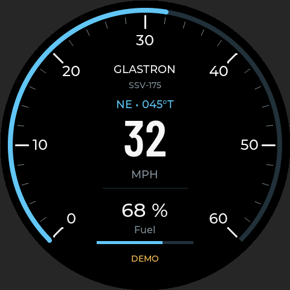

# Glastron SSV-175 GPS speedometer + fuel

Companion to the adjacent `../tach` project, for the Glastron SSV-175 with the
1984 Mercury 115 HP. Firmware targets the **Waveshare ESP32-S3-Touch-LCD-2.8C**,
round 480 x 480, with ESP-IDF 5.4.4 and vendored LVGL 8.3.11.
The source tree is independent of the tach project.



## Current behavior

- Matching black face, blue 270-degree **0-60 MPH** dial, large speed, fuel percent
  and bar. The dial endpoint is a display choice, not a boat speed specification.
- Direction sits above the digital speed, for example **NE • 045°T**: eight-point
  compass direction and GPS course relative to true north. It describes travel
  over ground, not the direction the bow points while stopped or drifting.
- The same official Glastron logo and SSV-175 ten-second startup as the tach.
- Tap the face for day/night brightness (100% / 20%) and blue/amber accent.
- `speed` build: explicit **DEMO** speed/fuel/course, with stopped, idle/no-wake,
  acceleration, cruise, low/empty fuel, and missing-data examples every 40 seconds.
- `speed-gps` build: real UART GPS speed from checksum-checked NMEA RMC.
  It displays **GPS** with a valid fresh speed, **GPS UNAVAILABLE** otherwise.
  Fuel shows `-- %` / `Fuel unavailable`; it is never simulated in GPS mode.
- Course shows `--` below **2 MPH**, without a valid fresh speed, or when the
  course is missing, invalid or stale. The cutoff is a provisional display policy
  to suppress low-speed GPS wander; it does not establish receiver accuracy.
- Independent two-second expiration; invalid or stale readings become dashes and
  the related arc/bar clears. Valid zero means stopped or empty, not missing data.

**Fuel sender acquisition and marine power conditioning are not implemented.**
Fuel below 15% is a provisional presentation threshold. No tank volume, range,
engine RPM conversion or wireless service is assumed. GPS mode can detect and
configure u-blox-compatible receivers at startup.
Host/firmware validation does not establish physical sensor accuracy.

## Build in PlatformIO / VS Code

Open this directory in VS Code with PlatformIO IDE (`platformio.platformio-ide`).
Select **speed** for the USB demo or **speed-gps** for actual GPS input.
The included Build, Upload and Monitor tasks use the selected environment.
The first build downloads the pinned SDK/toolchain. PlatformIO Espressif 32 6.11.0
uses ESP-IDF 5.4.4 and GCC 14.2.0 (`esp-14.2.0_20260121`). The local
`scripts/espidf` package adapter downloads Espressif's complete official release,
checks its SHA-256, and extracts the SDK components/tools. The upstream archive is
about 2 GB and is cached in `.pio/core/.cache/downloads`; later builds reuse it.
Generated assets and LVGL sources are included; no additional graphics library
installation is required.

```sh
pio run -e speed
pio run -e speed-gps
pio run -e speed-gps -t upload
pio device monitor -e speed-gps
```

Use **USB TO UART** to upload. Monitor demo firmware there at 115200 baud; GPS
firmware logs use the **native USB** port so console text cannot enter GPS RX.
Ports are autodetected;
set `upload_port` and `monitor_port` if multiple devices are connected. Close the
monitor before another program uses that port. These steps do not require GPS.

Each environment has its own generated config (`sdkconfig.speed`,
`sdkconfig.speed-gps`) and build directory (`.pio/build/<environment>/`). The GPS
environment applies `sdkconfig.gps.defaults` after the common defaults. A build
guard rejects a saved provider choice that disagrees with the environment; remove
that environment's generated config and rebuild to restore its defaults. Under
**Boat speedometer** in menuconfig, set brightness and the receiver's baud rate:

```sh
pio run -e speed-gps -t menuconfig
```

**Existing GPS configurations:** this change needs the USB Serial/JTAG console.
If the build rejects an older saved UART-console configuration, rename
`sdkconfig.speed-gps` to a backup outside the project and rebuild to apply the new
defaults (standalone IDF: back up `sdkconfig.gps`). Reapply custom settings after
regeneration. The demo configuration keeps its UART console.

The build's automatic PSRAM check verifies that LVGL's large arena is external,
preserving internal DMA memory. Do not add another LVGL `lib_deps` copy.
Use the PlatformIO terminal in VS Code so the CLI and extension use the same
PlatformIO Core. If a system `pio` reports an obsolete Core, use the extension's
bundled Core (`~/.platformio/penv/bin/pio` on this Mac). After changing SDK versions,
run **PlatformIO: Rebuild C/C++ Project Index** to refresh IntelliSense.

## GPS receiver and wiring

### Recommended receiver

Use the **Adafruit Ultimate GPS Breakout with GLONASS + GPS - PA1616D**,
**product ID 5440**:

- [Manufacturer product page / purchase link](https://www.adafruit.com/product/5440)
- [Manufacturer pinout and wiring guide](https://learn.adafruit.com/adafruit-ultimate-gps/pinouts)

This assembled breakout provides NMEA serial output at **9600 baud by default**,
ESP32-compatible **3 V UART output**, and a **3.3-5 V VIN** supply input. Its
GPS/GLONASS output can use the `GN` talker prefix, which this firmware supports.
Use the existing `speed-gps` build with `SPEED_GPS_BAUD=9600`. For this non-u-blox
receiver, disable **Detect/configure u-blox GPS at startup** in menuconfig and
confirm RMC output at least once per second. Its receive-only wiring is below.

The built-in patch antenna is suitable when it has a clear sky view. For mounting
under the Glastron's dash, use its **u.FL connector for an external 3 V active GPS
antenna**, adding a u.FL-to-SMA adapter if required by the antenna connector.
Mount the antenna where it can see the sky and protect the breakout and connections
from water. This is a component recommendation; this receiver has not yet been
tested with the physical gauge. Specifications checked on 2026-11-21; check current
availability before ordering.

### Connections

Use a receiver/module that emits **NMEA RMC** (`GPRMC`, `GNRMC`, or another uppercase
two-letter talker) through a **3.3 V logic UART**, **9600 baud, 8N1** by default.
Match `SPEED_GPS_BAUD` to the actual receiver if different. Configure the receiver
to output RMC at least once per second; sentence gaps over two seconds expire speed.
The table below applies to the recommended Adafruit #5440 breakout.

| Receiver connection | Display connection |
|---|---|
| TX, 3 V logic output | External UART **RXD**, ESP32 **GPIO44** |
| GND | GND |
| RX | Leave unconnected; firmware sends no commands |
| VIN | Clean regulated **5 V** supply; never the raw boat 12 V feed |

Connect power to **VIN**, not the breakout's **3.3V regulator-output** pin.
Keep receiver and display grounds common. Other receiver models need their own
supply/interface check before using this wiring.

The board's 4-pin UART header and 12-pin interface expose the same switched UART
signals. Follow **signal labels**, not guessed connector order or wire colors.
Do not connect RS-232, differential NMEA 0183, or 5 V UART signals directly to RXD;
those require the appropriate receiver/level interface. A 5 V powered GPS breakout
does not necessarily have a 3.3 V TX signal.

**Board-specific USB switch:** plugging in **USB TO UART disables the external
UART header**. To run with GPS, upload first, unplug USB TO UART, and power the
board through its **native USB** port or a verified regulated supply. Keep USB TO
UART disconnected while receiving GPS. Serial monitoring through that port will
temporarily disconnect the GPS input; the UI then expires the speed reading.
UART1 receives GPS on GPIO44. GPS-build diagnostic logs use native USB Serial/JTAG.
For the receive-only Adafruit wiring, leave display TXD and GPS RX unconnected.

### GY-NEO6MV2 / NEO-6M and GT-U7 automatic setup

The GPS build enables `SPEED_GPS_AUTOCONFIG` by default. A GY-NEO6MV2 with a
NEO-6M or a **u-blox-compatible GT-U7** can use the following wiring instead:

| Receiver connection | Display / supply connection |
|---|---|
| TX / TXD, 3.3 V logic | RXD, GPIO44 |
| RX / RXD, 3.3 V logic | **TXD, GPIO43** (required for configuration) |
| GND | Common ground |
| VCC | Clean regulated 5 V **only if that breakout is rated for 5 V input** |
| PPS, if present | Leave unconnected |

Common GY-NEO6MV2 and GT-U7 breakouts have an onboard regulator; check the exact
board's supply rating. The bare NEO-6M module accepts only 2.7–3.6 V. Never apply
boat battery voltage or 5 V logic to GPS/ESP32 UART pins. Follow printed signal
labels; the connector order can differ between modules. Attach the supplied
antenna, place it with sky visibility, and protect the assembly from water.

Startup probes the configured baud first (9600 by default), then the other rates
in **4800, 9600, 19200, 38400, 57600, 115200, 230400**, using 8N1. Only a valid
UBX MON-VER response permits configuration. This detects protocol compatibility
and reports receiver software/hardware versions; it cannot identify the carrier
board or prove that its chip is genuine. A normal no-response scan takes about
8.4 seconds and runs alongside the logo/display loop without sleeping.

Once detected, the receiver gets UART1 settings for the selected baud, UBX/NMEA
input/output, 1000 ms measurement/navigation updates, and RMC every solution.
Port settings are read back after the baud switch; rate/message commands need
matching ACKs and readback before logs say **GPS settings verified**. Changes
apply in **RAM each startup**, with no EEPROM save or factory reset. Other
receiver settings and message subscriptions are retained.

Missing/negative/corrupt replies or a missing return wire cannot establish
configuration success. After bounded retries the firmware listens for ordinary
NMEA at `SPEED_GPS_BAUD`; restart the display to repeat discovery. No fix is needed
for UBX detection, but speed remains unavailable until a valid satellite fix.
Saved non-8N1 framing, UBX input disabled, unsupported baud rates, or excessive
pre-existing message traffic may require manual receiver setup. A replacement or
restarted receiver that loads different saved settings needs a display restart.

Disable **Detect/configure u-blox GPS at startup** for receive-only wiring or
non-u-blox receivers, and configure their NMEA baud/RMC rate separately. With the
option enabled, plug into **native USB** to monitor detection/configuration logs;
keep **USB TO UART unplugged**. ROM reset messages can briefly appear on GPIO43
before the USB bootloader console takes over.

References: [u-blox 6 protocol specification](https://content.u-blox.com/sites/default/files/products/documents/u-blox6_ReceiverDescrProtSpec_%28GPS.G6-SW-10018%29_Public.pdf),
[GY-NEO6MV2 breakout specification](https://www.cytron.io/p-gy-neo6mv2-flight-control-gps-module),
[GT-U7 vendor manual](https://shillehtek.com/blogs/shillehtek-product-manuals/gt-u7-gps-module-presoldered-1-manual).
Both owned module types still require testing with the physical gauge.

This switch behavior and pin map are documented in the
[official Waveshare board interfaces](https://docs.waveshare.com/ESP32-S3-Touch-LCD-2.8C).

Mount the antenna with sky visibility. A connected receiver without a valid fix
must display unavailable speed. GPS measures **speed over ground**, so water
current can make it differ from a pressure or paddlewheel speedometer.

## GPS data handling

`gps_nmea.c` accepts complete RMC sentences with a mandatory XOR checksum and
strict nonnegative decimal knots, converting to MPH by 1.150779448. Active status
`A` and measured modes `A`, `D`, `P`, `R`, `F` are accepted; legacy RMC without a
mode field is supported. Void status, bad speed, or non-measured/unknown mode
clears speed immediately. In particular, simulated/manual/estimated positions
cannot appear as measured speed. Navigation-status `V` at the end of modern RMC
is distinct from the data-validity status and does not itself void the fix.

The course field immediately after speed accepts strict nonnegative decimal
degrees in `[0, 360)`. Missing/malformed course clears direction independently,
preserving a valid speed. Void fixes and UART stream failures clear direction
along with speed. The display rounds to whole degrees, wraps a rounded 360° to
000°, and selects N/NE/E/SE/S/SW/W/NW. Course expires after two seconds and is shown
only with fresh speed at or above 2 MPH, using the unrounded speed for this check.
The existing RMC sentence and UART wiring supply both speed and direction.

Bad checksums, incomplete/overlong lines, unsupported sentence types and stream
noise never refresh sample age. `$` resynchronizes the stream. The parser has a
160-byte fixed buffer, no dynamic allocation and no third-party GPS dependency.
Partial sentences expire after two seconds; embedded carriage returns and extra
RMC fields are rejected. Input buffered across a service gap over two seconds is
discarded so old fixes cannot acquire a fresh timestamp on task resumption.
The UART shell handles at most 256 bytes and 16 events each loop, polls during
startup, and discards and invalidates data after UART overflow or framing errors.
Inputs above 200 MPH are rejected as a software sanity bound; readings above
60 MPH remain numeric while the display arc stops at its endpoint.

Protocol references: [u-blox RMC description](https://content.u-blox.com/sites/default/files/products/documents/u-blox8-M8_ReceiverDescrProtSpec_UBX-13003221.pdf),
[ESP-IDF 5.4.4 UART API](https://docs.espressif.com/projects/esp-idf/en/v5.4.4/esp32s3/api-reference/peripherals/uart.html).

## Host tests and previews

Requires CMake, a C11 compiler, Ninja and Python 3 (for build-source guard tests).
Pillow is only needed to regenerate fonts/logo or convert PPM images; normal
firmware builds use included C assets.
Helper dependencies are pinned in `requirements.txt` (Python 3.11 or newer).

```sh
sh scripts/test-model.sh
cmake -S tests -B build-host -G Ninja -DCMAKE_BUILD_TYPE=Debug
cmake --build build-host
ctest --test-dir build-host --output-on-failure
build-host/render-ui gps preview.ppm
```

The model and GPS tests run under address/undefined-behavior sanitizers via the
shell script. The CMake suite also checks startup timing and renders the **actual
firmware C/LVGL face**, including value changes, expiry, zero and recovery.
It exercises the real UART provider against a small host IDF boundary, including
buffer discard after service gaps, UART errors and recovery. Hardware UART timing
and reception still require a board.
Scenes: `normal`, `low`, `empty`, `missing`, `speed-missing`, `fuel-missing`, `gps`,
`gps-waiting`, `stopped`, `night`, `startup`, `course-missing`, `course-slow`,
`course-north`. PNG examples are in `previews/`.
Gray corners mark pixels outside the physical circular panel.

## Source map and fuel integration

| File | Responsibility |
|---|---|
| `main/board.c`, `panel_init.h` | Inherited board pin map, LCD, touch and brightness |
| `main/main.c` | Watchdog/event loop and explicit provider selection |
| `main/speed_model.c` | Independent timestamped readings and demo scenarios |
| `main/gps_nmea.c` | Host-testable streaming RMC parser |
| `main/gps_uart.c` | Bounded ESP-IDF UART1 acquisition and configuration transport |
| `main/gps_ublox.c` | Host-testable UBX discovery, configuration and readback |
| `main/speed_ui.c` | Sensor-independent LVGL face |
| `main/speed_startup.c` | Nonblocking visible-time Glastron startup |

When the protected, calibrated fuel interface is ready, publish a percent through
`speed_model_set_fuel(&model, percent, now_ms)` at the hook in `main.c`.
Stop publishing on failed acquisition, or publish `NAN` to invalidate immediately.
Use a FreeRTOS queue if another task acquires readings; keep model and LVGL updates
on the application task. No sender resistance, ADC pin, tank size or curve is
assumed. Never connect a boat sender or 12 V feed directly to this board.

## Standalone ESP-IDF

With ESP-IDF 5.4.4 activated:

```sh
export IDF_COMPONENT_MANAGER=0
idf.py build
idf.py -B build-gps -DSDKCONFIG=sdkconfig.gps -DBOAT_GPS_BUILD=ON build
```

The project defaults to `esp32s3` before IDF selects the compiler. If an existing
`build`/`sdkconfig` was generated for `esp32`, back up any custom menuconfig
settings and run `idf.py set-target esp32s3` once before building. The VS Code
ESP-IDF extension also disables the component manager through workspace settings;
LVGL is vendored locally. PlatformIO uses its separate `.pio` SDK and build tree.

The first command builds the demo; the second uses separate GPS config/output.
PlatformIO produces `firmware.elf`; standalone IDF produces `boat_speed.elf`.
`scripts/check-memory.py ELF --objdump TOOL` accepts either. The inherited
`scripts/package-firmware.py` packages demo builds only (standalone ELF name by
default); it refuses to label live GPS firmware as a demo. No prebuilt release
or hardware flash is implied by the source being present.

## Hardware acceptance remaining

Verify actual boot/colors/orientation, ten visible seconds of logo, touch and
brightness, extended operation and helm readability. Then test receiver supply,
UART voltage/baud, cold-start acquisition outdoors, stopped/moving accuracy,
loss of antenna/fix, unplug/reconnect and USB-mux behavior. Compare GPS speed to
an independent reference. Fuel needs sender measurements/calibration. A permanent
boat installation also needs protected regulated power and suitable mounting.

See `docs/validation.md` for checks actually run and `THIRD_PARTY.md` for provenance.
